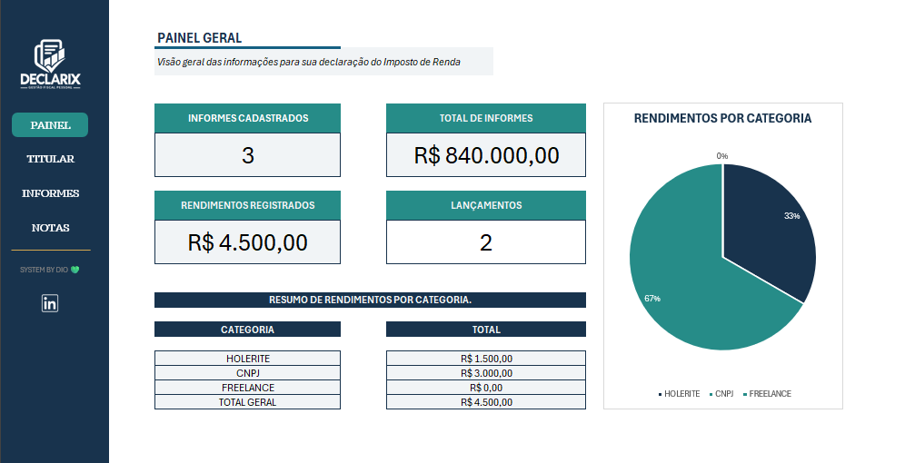
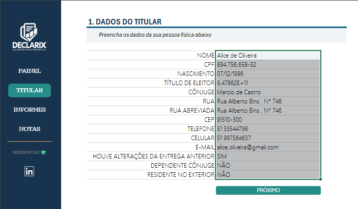
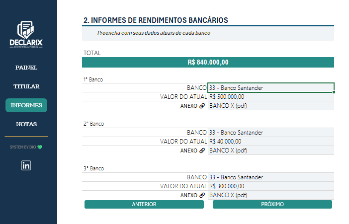
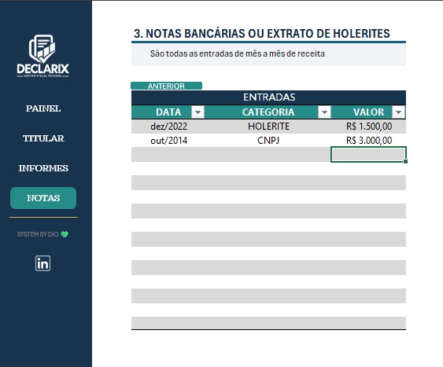

# DECLARIX — Gestão Fiscal Pessoal

**Organização, automatização e visualização de informações fiscais em Excel.**

O DECLARIX é uma ferramenta desenvolvida em Microsoft Excel para organizar informações pessoais, informes financeiros e registros de rendimentos, oferecendo uma visualização centralizada dos dados por meio de um painel gerencial.

O projeto foi desenvolvido a partir de uma atividade prática da DIO e posteriormente aprimorado com identidade visual própria, indicadores automáticos e recursos de visualização de dados.

## 🎯 Objetivo

O objetivo do DECLARIX é facilitar a organização e a consulta de informações necessárias para a preparação da declaração do Imposto de Renda.

A ferramenta busca oferecer:

- Centralização das informações em um único arquivo.
- Padronização do preenchimento dos dados.
- Automatização de cálculos.
- Redução de erros por meio de validações.
- Visualização rápida dos principais indicadores financeiros.

  ## ⚙️ Funcionalidades

- **Cadastro do titular:** organização dos dados pessoais do contribuinte.
- **Informes financeiros:** registro de instituições financeiras e valores correspondentes.
- **Registro de rendimentos:** lançamento de informações por data, categoria e valor.
- **Painel gerencial:** visualização centralizada dos principais indicadores.
- **Indicadores automáticos:** acompanhamento da quantidade de informes, valores totais e lançamentos.
- **Resumo por categoria:** consolidação dos rendimentos utilizando fórmulas.
- **Gráfico de rosca:** representação visual da distribuição dos rendimentos.
- **Validação de dados:** listas suspensas, mensagens de orientação e alertas de erro.
- **Proteção de planilhas:** preservação das fórmulas e estruturas do arquivo.
- **Menu de navegação:** acesso organizado às diferentes abas.

  ## 📊 Estrutura da planilha

O DECLARIX está organizado em cinco abas:

| Aba | Descrição |
|---|---|
| PAINEL | Apresentação dos indicadores e gráficos gerenciais. |
| TITULAR | Cadastro das informações pessoais do contribuinte. |
| INFORMES | Registro de instituições financeiras e valores dos informes. |
| NOTAS | Registro de rendimentos por data, categoria e valor. |
| TABELAS | Armazenamento de dados auxiliares para validações. |

## 🛠️ Tecnologias e recursos

- Microsoft Excel
- Fórmulas e funções: SOMA, CONT.VALORES, CONT.NÚM e SOMASE.
- Validação de dados.
- Listas suspensas.
- Tabelas estruturadas.
- Gráficos.
- Formatação condicional e personalizada.
- Proteção de planilhas.
- Organização e visualização de dados.
- Markdown para documentação.

  ## 🖥️ Demonstração visual

### 1. Painel geral

### 2. Cadastro do titular

### 3. Informes bancários

### 4. Registro de rendimentos

## 🚀 Evolução do projeto

O DECLARIX foi desenvolvido a partir de uma planilha disponibilizada em uma atividade prática da DIO.

A versão aprimorada apresenta melhorias em relação ao modelo original:

- Criação de uma identidade visual própria.
- Desenvolvimento de um painel gerencial.
- Inclusão de indicadores automáticos.
- Consolidação dos rendimentos por categoria.
- Criação de gráfico para visualização dos dados.
- Implementação de menu lateral para navegação.
- Padronização das validações de dados nos campos de instituições financeiras.

## 📚 Aprendizados

O desenvolvimento deste projeto proporcionou a aplicação prática de conhecimentos em:

- Organização e estruturação de dados.
- Automatização de cálculos no Excel.
- Validação e padronização de informações.
- Criação de indicadores e gráficos.
- Visualização de dados.
- Proteção de planilhas.
- Organização da experiência do usuário.
- Documentação e versionamento de projetos no GitHub.

  ## 👩‍💻 Autora

**Gabriela Bittencourt**

Projeto desenvolvido como atividade prática de Excel da [DIO](https://www.dio.me/), com melhorias e funcionalidades adicionais implementadas de forma autoral.

---

⭐ Projeto desenvolvido para fins educacionais e de portfólio.
